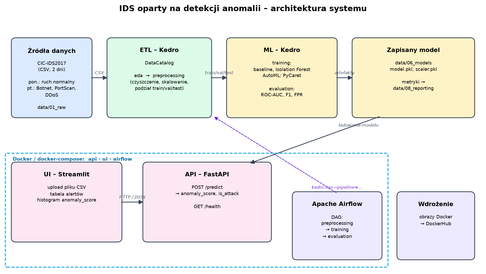
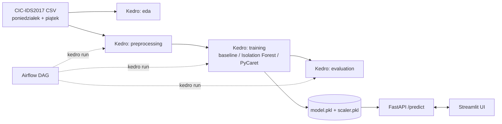

# Architektura – IDS (detekcja anomalii)

Diagram generuje `python scripts/draw_architecture.py`.

| Moduł | Opis |
|---|---|
| **ETL (Kedro)** | wczytanie 4 plików CSV z `data/01_raw`, EDA, czyszczenie (inf/NaN, duplikaty, kolumny stałe), skalowanie, podział: train = poniedziałek, val/test = piątek |
| **ML** | trening detektora na ruchu normalnym, dobór progu (FPR ≤ 1%), metryki, zapis modelu do `data/06_models` |
| **API (FastAPI)** | `POST /predict` przyjmuje przepływy i zwraca `anomaly_score` oraz `is_attack`; `GET /health` |
| **UI (Streamlit)** | upload pliku CSV, tabela podejrzanych przepływów, histogram wyników |
| **Airflow** | DAG: preprocessing → training → evaluation |
| **Docker** | docker-compose z serwisami `api` i `ui` |
