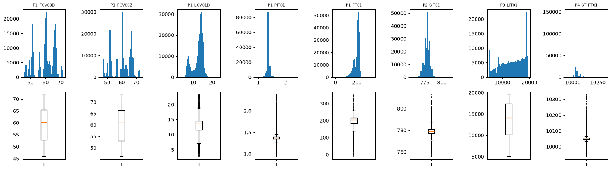

# Raport EDA: IDS na danych OT (HAI 21.03)

Analiza: [`notebooks/EDA_s28129.ipynb`](../notebooks/EDA_s28129.ipynb). Wykresy i tabele tworzy `kedro run --pipeline=eda`.

## Dane

[HAI 21.03](https://github.com/icsdataset/hai) to pomiary co sekundę ze stanowiska z prawdziwymi sterownikami PLC. Używamy `train1` (216 001 wierszy, sama normalna praca) oraz `test1` i `test2` (162 002 wiersze, 25 ataków). Każdy plik ma `time`, 79 punktów pomiarowych i 4 etykiety.

## Główne obserwacje

- Nie ma braków ani duplikatów, ale 22 kolumny są stałe w `train1`.
- To szereg czasowy: sąsiednie sekundy są prawie identyczne.
- Rozkłady mają kilka szczytów, a skala zmiennych jest bardzo różna.
- Ataki to 2,5% rekordów testowych.
- Wiele par zmiennych jest silnie skorelowanych, ale ich rozjazd bywa objawem ataku.

## Decyzje

Po decyzjach zostaje 56 cech: 79 − 22 stałe − `P4_ST_PS`.

| # | Decyzja | Dlaczego | Przykład |
|---|---|---|---|
| D1 | HAI 21.03 zamiast CIC-IDS2017 | projekt dotyczy OT, a CIC-IDS2017 to ruch biurowy | realne PLC, `train1` bez ataków |
| D2 | tylko `train1`, `test1`, `test2` | tyle wystarczy i dane są małe | 60 h normalnej pracy, 25 ataków, 53 MB |
| D3 | podział po plikach, nie losowy | sąsiednie sekundy są prawie identyczne | autokorelacja 0,99 po 1 s |
| D4 | usuwamy 22 kolumny stałe w train | jedna wartość nie uczy modelu | `P1_PP02D` zawsze 1 |
| D5 | etykieta to tylko `attack`, `time` nie jest cechą | etykiety procesów są niepełne, czas to harmonogram testów | 154 rekordy ataku bez procesu |
| D6 | zostawiamy wartości odstające | w train to prawdziwe stany instalacji | `P4_HT_FD`: 0,8% powyżej 5 odchyleń |
| D7 | usuwamy tylko `P4_ST_PS` | to kopia, a pozostałe korelacje niosą sygnał ataku | `FCV03`: rozjazd w 0,01% normalnych i 4,8% ataków |
| D8 | bez accuracy | ataki to 2,5% rekordów | brak alarmów daje 97,5% |

## Dalsze kroki

Etap 3: usunąć kolumny według D3, D4, D7, podzielić dane po plikach (`train1` trening, `test1` walidacja, `test2` test) i dopasować standaryzację tylko na `train1`.
