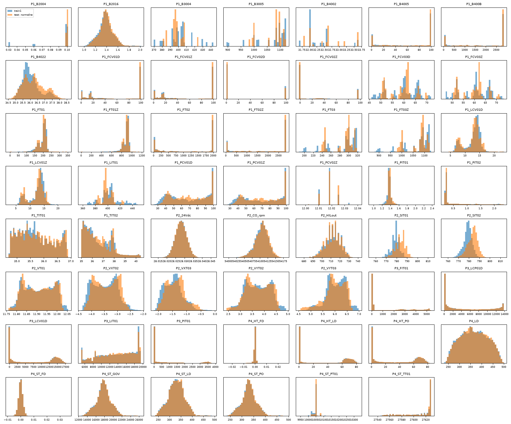
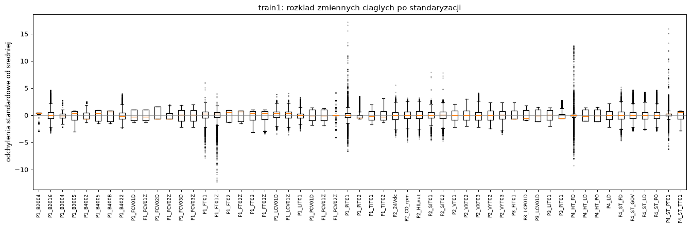
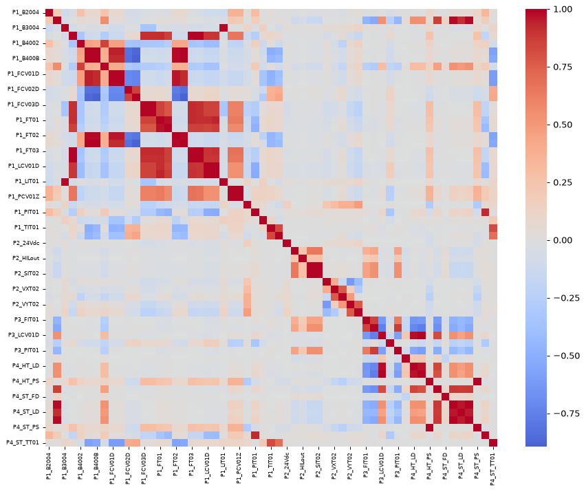
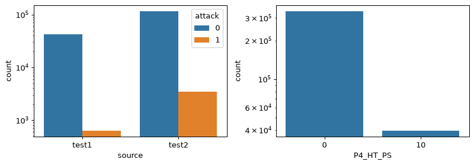
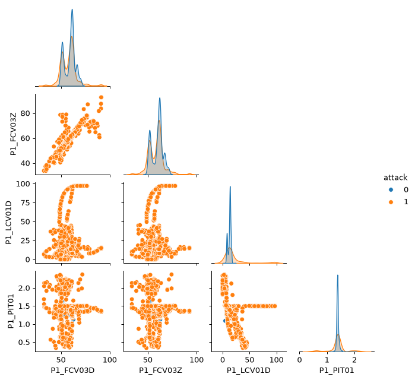
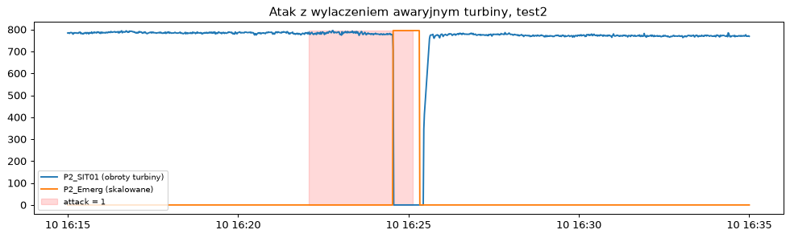

# Raport EDA: IDS na danych OT (HAI 21.03)

Pełna analiza: [`notebooks/EDA_s28129.ipynb`](../notebooks/EDA_s28129.ipynb). Wykresy i tabele tworzy `kedro run --pipeline=eda`.

## 1. Opis danych

[HAI 21.03](https://github.com/icsdataset/hai) (licencja CC BY-SA 4.0) to pomiary ze stanowiska hardware-in-the-loop z prawdziwymi sterownikami PLC: kocioł (P1), turbina (P2), uzdatnianie wody (P3) i symulacja zapotrzebowania na moc (P4). Każdy wiersz to stan instalacji w jednej sekundzie.

| Plik | Wiersze | Okres (2020) | Ataki | Udział rekordów ataku | Rola |
|---|---|---|---|---|---|
| `train1` | 216 001 | 11.07 00:00 – 13.07 12:00 | 0 | 0% | trening |
| `test1` | 43 201 | 7.07 15:00 – 8.07 03:00 | 5 | 1,5% | walidacja |
| `test2` | 118 801 | 9.07 15:00 – 11.07 00:00 | 20 | 2,9% | test |

Każdy plik ma 84 kolumny: `time`, 79 punktów pomiarowych i 4 etykiety. README zbioru podaje 78 punktów, a w plikach jest ich 79.

## 2. Główne obserwacje

**Jakość danych**
- Nie ma braków ani duplikatów, a pomiary są co sekundę bez przerw.
- 19 kolumn jest stałych we wszystkich plikach, a 3 kolumny są stałe tylko w `train1`.
- Ostatni wiersz `test2` i pierwszy wiersz `train1` to ten sam pomiar.
- 154 rekordy ataku nie mają etykiety procesu (`attack_P*`).
- `P1_PP01AD` według dokumentacji jest typu Boolean, a w plikach ma stałą wartość 540833.

**Charakter danych**
- To szereg czasowy: autokorelacja po 1 sekundzie to 0,999, a po minucie 0,80.
- Plik treningowy jest późniejszy niż pliki testowe.
- Rozkłady są wielomodalne, bo instalacja pracuje w kilku stanach ustalonych.
- Skala zmiennych jest bardzo różna: odchylenie standardowe od 0,0016 do 6823.
- Ataki to 2,5% rekordów testowych i trwają od 17 do 422 sekund.

**Korelacje:** 13 par zmiennych ma |r| > 0,99, ale w parach polecenie/położenie zaworu zależność potrafi się rozjechać podczas ataku. Dlatego korelacja nie jest tu powodem do usuwania kolumn.

**Etykiety i zmienne kategoryczne:** większość rekordów ataku dotyczy procesu P1. Kolumny stałe w `train1` zmieniają się tylko w trakcie ataku albo tuż po nim.

**Pary zmiennych:** ataki często leżą poza główną chmurą punktów, ale mocno na nią zachodzą.

**Etykieta kończy się przed skutkiem ataku:** przez pierwszą minutę po ataku rekordy są wyraźnie dalej od normy (średnia odległość 0,98 wobec około 0,78).

**Test prostego detektora:** Isolation Forest na pojedynczych rekordach (5 ziaren, próg to 99. percentyl wyniku na danych treningowych) to tylko test decyzji o danych, a nie model z etapu 4.

| Dane treningowe | Wiersze | ROC-AUC | Recall | FPR | Wykryte ataki z 25 |
|---|---|---|---|---|---|
| train1 | 216 000 | 0,71 | 0,06 | 0,9% | 9,6 |
| train1+2+3 | 921 602 | 0,73 | 0,06 | 0,6% | 10,8 |

Wynik jest słaby, bo model nie widzi przebiegu w czasie, a wiele ataków mieści się w normalnym zakresie wartości.

## 3. Decyzje o danych

Po decyzjach zostaje 56 cech: 79 − 19 stałych − 3 stałe w train − `P4_ST_PS`.

| # | Decyzja | Dlaczego | Przykład z danych |
|---|---|---|---|
| D1 | HAI 21.03 zamiast CIC-IDS2017 | projekt dotyczy OT, a CIC-IDS2017 to ruch biurowy; HAI ma realne PLC i publiczny dostęp | pliki train mają 0 rekordów ataku |
| D2 | tylko `train1`, `test1`, `test2` | 4 razy więcej danych to tylko około +0,02 ROC-AUC i bez poprawy recall | `P1_B2004`: 17% poza zakresem, ale o 0,02 odchylenia |
| D3 | podział po plikach, nie losowy | sąsiednie sekundy są prawie identyczne, więc losowy podział zawyżyłby wynik | autokorelacja 0,999 po 1 s |
| D4 | usunięcie 1. wiersza `train1` | ten sam pomiar jest w train i test | 11.07 00:00:00, 79 z 79 wartości zgodnych |
| D5 | usunięcie 19 kolumn stałych | jedna wartość nie niesie informacji | `P1_PP02D` zawsze równe 1 |
| D6 | 3 kolumny stałe w train poza modelem, jako reguła | model się ich nie nauczy, ale sygnał jest silny | `P1_PCV02D` ≠ 12: 185 rekordów, wszystkie atak; reguła łapie 5 z 25 ataków |
| D7 | tylko etykieta `attack` | `attack_P*` są niepełne i byłyby przeciekiem | 154 rekordy ataku bez procesu |
| D8 | bez accuracy, liczymy też wykryte ataki | ataki to 2,5% rekordów | brak alarmów daje 97,5% accuracy |
| D9 | `time` nie jest cechą | model nauczyłby się harmonogramu testów | w godzinach 0, 2, 4, 6, 8, 11, 13, 14 brak ataków |
| D10 | zostawiamy wartości odstające | w train to prawdziwe stany instalacji | `P4_HT_FD`: 0,8% rekordów powyżej 5 odchyleń |
| D11 | zostawiamy `P1_PCV02Z`, obcinamy z-score w baseline | małe odchylenie sztucznie powiększa różnice | 12,26 zamiast 12,02 to ponad 40 odchyleń |
| D12 | nie usuwamy skorelowanych, dodajemy `D − Z` | rozjazd polecenia i położenia to objaw ataku | `FCV03`: 0,01% rekordów normalnych, 4,8% ataku |
| D13 | usuwamy `P4_ST_PS` | dokładna kopia `P4_HT_PS` także podczas ataków | 0→0, 10→50 w każdym rekordzie |
| D14 | pairplot: 5 zmiennych, po 1500 rekordów na klasę | 56 zmiennych to 1540 wykresów, a ataki by zniknęły | wybór według statystyki KS |
| D15 | etykiety bez zmian, FPR także bez 60 s po ataku | skutek ataku trwa dłużej niż etykieta | `P2_Emerg`: 47 s, z tego 35 s z etykietą |
| D16 | cechy czasowe w etapie 3 | model widzi tylko pojedyncze sekundy | test: około 10 z 25 wykrytych ataków |

## 4. Dalsze kroki (etap 3)

1. **Czyszczenie:** usunąć kolumny i wiersz według D4, D5, D6 i D13.
2. **Podział:** `train1` do treningu, `test1` do walidacji, `test2` do testu.
3. **Feature engineering:** różnice `D − Z` oraz średnia i zmiana z okien czasowych, np. 60 sekund.
4. **Standaryzacja:** dopasować tylko na `train1`, a w baseline obciąć wartości do ±10.
